# documentario-mural-motion-graphics

Skill para o **Claude Code** que produz vídeos documentários educativos em **motion graphics 2.5D**, no estilo "mural de investigação" (tachinhas, fio vermelho, mapas e fotos de arquivo) com toques do "estilo Vox" (retícula, duotone, recortes em camadas).

Tudo é animado em código: nenhuma imagem é gerada por IA. As fotos, gravuras e mapas vêm de acervos em **domínio público** (The Met Open Access, Library of Congress) e o mapa base é o **Natural Earth**.

> *English summary:* a Claude Code skill that turns a script into a ~10-minute 2.5D "investigation board" documentary (1920×1080), with continuous camera, public-domain archive images pinned with red string, animated maps, timeline, narrated chapters (Kokoro TTS), automatic layout QA, two thumbnail options, and vertical Vox-style Shorts. Channel identity (name, voice, language, on-screen labels) lives in a profile JSON — see `perfis/default-en.json`.


## Como fica

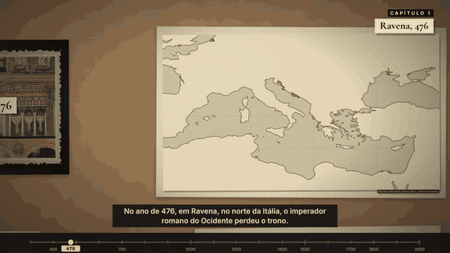

*Câmera contínua: a câmera desliza pelo mural, aproxima nos detalhes e se afasta para o mapa, sem cortes.*

| | |
|---|---|
| 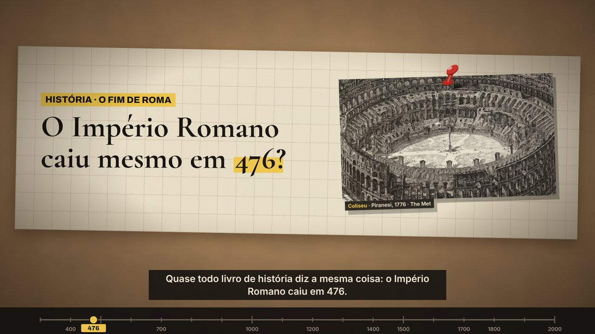 | 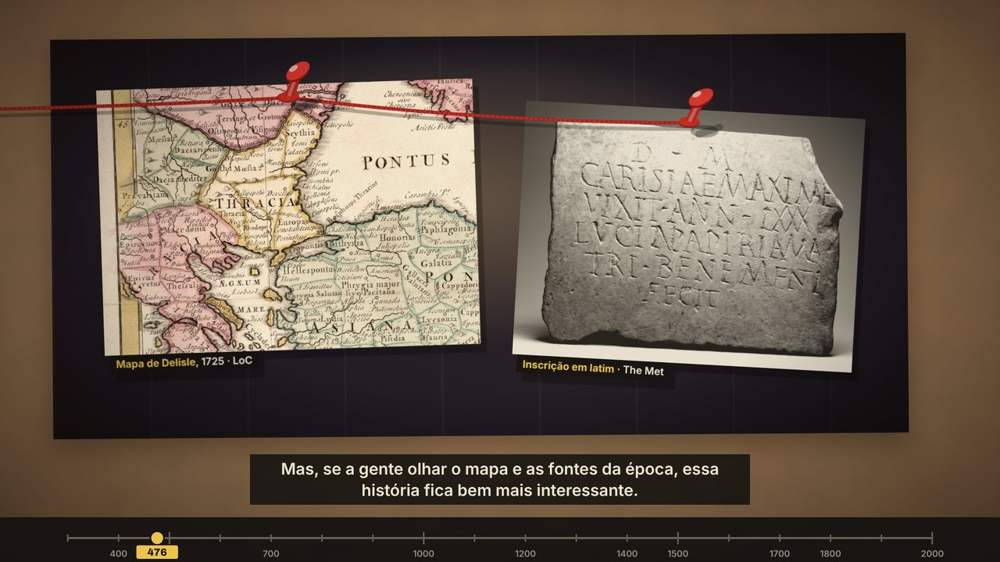 |
| **Abertura** com marca-texto no título e gravura presa com tachinha | **Fios vermelhos** ligando as pistas, polaroide e lista dos capítulos |
| 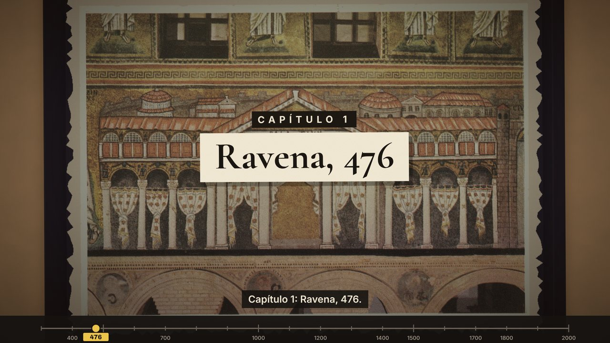 | 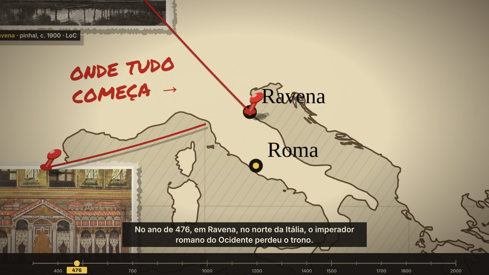 |
| **Cartão de capítulo** sobre foto grande, narrado | **Mapa animado** com fotos presas no lugar exato e anotação à mão |
| 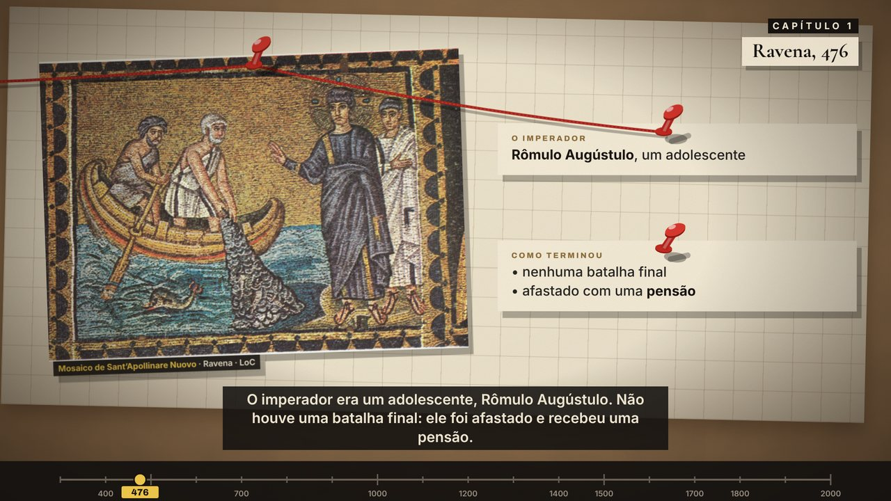 | 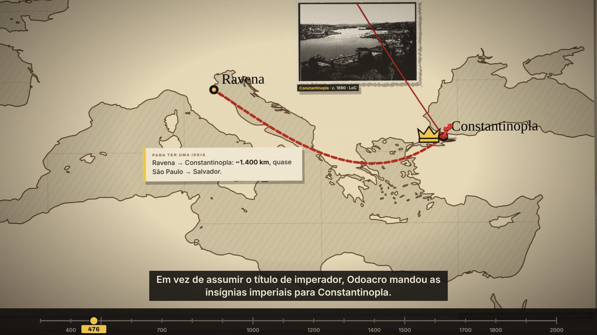 |
| **Imagem de acervo** com notas e linha do tempo fixa no rodapé | **Rota animada** e caixa "palavra-chave" |
| 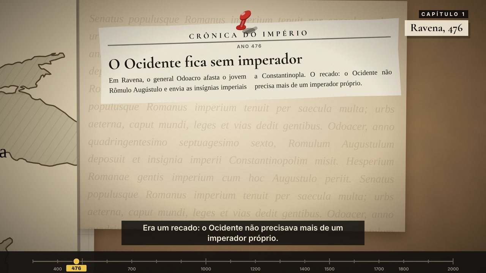 | 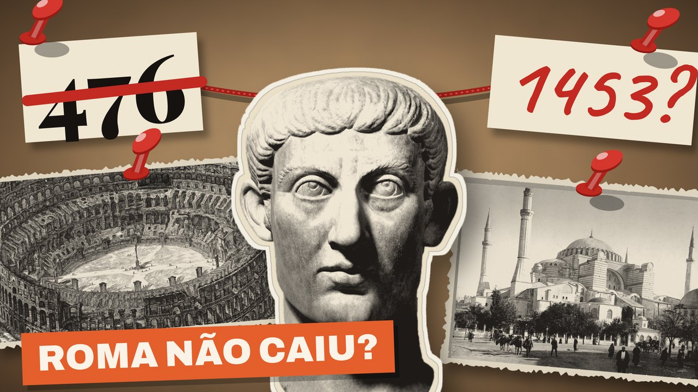 |
| **Recorte de jornal** com trecho sublinhado | **Capa — opção 1 (cortiça)** |
| 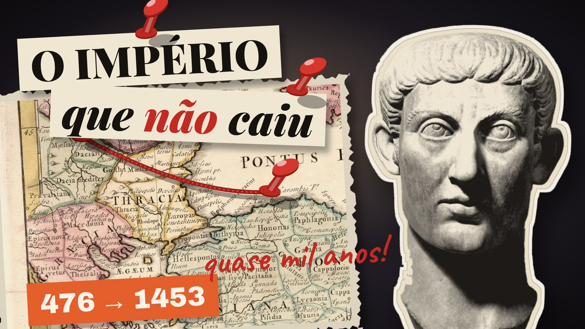 |  |
| **Capa — opção 2 (mesa escura)** | **Capa do Short** (estilo Vox) |

**Temas de mural** — cortiça (história), quadro branco com tachinhas azuis (ciência) e caderno pautado (corpo humano / "como funciona"):

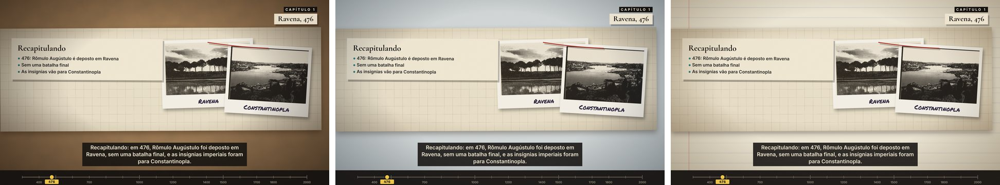

**Shorts verticais no estilo Vox**, tirados do vídeo longo (retícula, duotone, letras com imagem dentro, recortes em camadas, setas à mão, etiquetas):

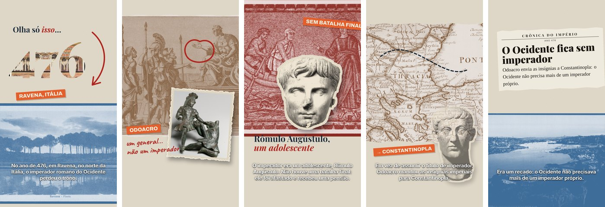

*Imagens do exemplo: The Met Open Access e Library of Congress (domínio público); mapa base Natural Earth.*

## O que ela faz

- **Vídeo longo** horizontal (1920×1080, ~10 min) com câmera contínua sobre o mural, profundidade 2.5D e fundo desfocado.
- **Mural automático**: você descreve cada trecho num `plano.json` e a skill posiciona fotos, notas, mapas, tachinhas, fios vermelhos e movimentos de câmera.
- **Recursos educativos**: linha do tempo fixa, mapa que se transforma, "palavra-chave", "onde fica", "você sabia?", "para ter uma ideia", rótulos "quem é quem", fonte da época na tela, recapitulações narradas.
- **Efeitos**: foto revelada, polaroides, recorte de jornal com sublinhado, camadas de primeiro plano.
- **3 temas de mural**: cortiça (história), quadro branco (ciência), caderno (corpo humano / "como funciona").
- **Checagem automática** de layout: aponta texto embaixo da legenda, cortado na borda ou sobreposto.
- **2 opções de capa** 16:9 (cortiça e mesa escura) e **capa de Short**.
- **Shorts verticais** (1080×1920) tirados do longo, no estilo Vox ou no estilo mural.
- **Perfil do canal**: nome, @, voz, idioma, vinheta final e todos os textos de tela são configuráveis.

## Instalação

1. Copie esta pasta para `~/.claude/skills/documentario-mural-motion-graphics/` (ou para `.claude/skills/` do seu projeto).
2. Dependências:
   ```bash
   pip install -r requirements.txt
   ```
   ```bash
   npm install
   ```
   ```bash
   npx playwright install chromium
   ```
   E o **ffmpeg** instalado no sistema.
3. Baixe o modelo de voz **Kokoro** (`kokoro-v1.0.onnx` e `voices-v1.0.bin`) da release *model-files-v1.0* do repositório [thewh1teagle/kokoro-onnx](https://github.com/thewh1teagle/kokoro-onnx) e guarde numa pasta, por exemplo `~/kokoro/`.

## Teste rápido com o exemplo (Roma, 476)

```bash
python3 exemplo/baixar_imagens.py
```
```bash
python3 scripts/narr.py exemplo --kokoro ~/kokoro
```
```bash
python3 scripts/gerar_mural.py exemplo && python3 scripts/build.py exemplo
```
```bash
node scripts/checar.js exemplo 1
```
```bash
python3 scripts/mix.py exemplo && scripts/render.sh exemplo exemplo.mp4
```

Prévia de quadros soltos: `node scripts/render.js exemplo 5 30 60` (PNGs em `exemplo/previa/`).
Capas: `python3 scripts/capa_vox.py exemplo exemplo/capa-cortica.json capa.png`.
Short estilo Vox: `python3 scripts/vox_short.py exemplo exemplo/short-vox.json short.mp4`.

## Usando com o Claude Code

Peça algo como *"faz um documentário de 10 minutos sobre a Rota da Seda no estilo mural"*. A skill guia o fluxo: pesquisa com fontes → roteiro com 3 ganchos → imagens de domínio público → narração → mural automático → checagem → render → 2 capas → Shorts. O passo a passo completo está em [`SKILL.md`](SKILL.md) e o guia visual em [`references/estilo.md`](references/estilo.md).

## Perfil do canal

Copie `perfis/padrao-pt-br.json` (ou `perfis/default-en.json`) para `SEU_PROJETO/perfil.json` e edite: nome e @ do canal, voz Kokoro (`pm_alex`, `pf_dora`, `am_michael`, `af_heart`…), idioma, tema de mural padrão, imagem opcional da vinheta final e todos os textos de tela.

## Créditos e licenças

- Código desta skill: licença MIT (veja `LICENSE`).
- Bibliotecas e dados de terceiros: veja `THIRD_PARTY.md`.
- As imagens do exemplo **não** estão no repositório: o script `exemplo/baixar_imagens.py` baixa diretamente dos acervos públicos. Sempre credite o acervo na tela e na descrição.
- Vozes geradas por IA: marque o vídeo como "conteúdo alterado ou sintético" onde a plataforma pedir.
